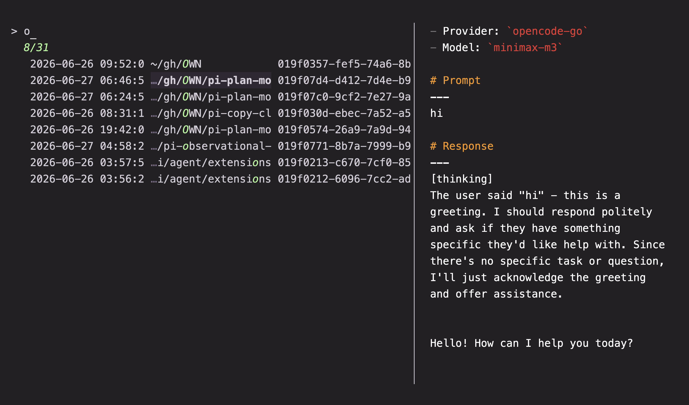
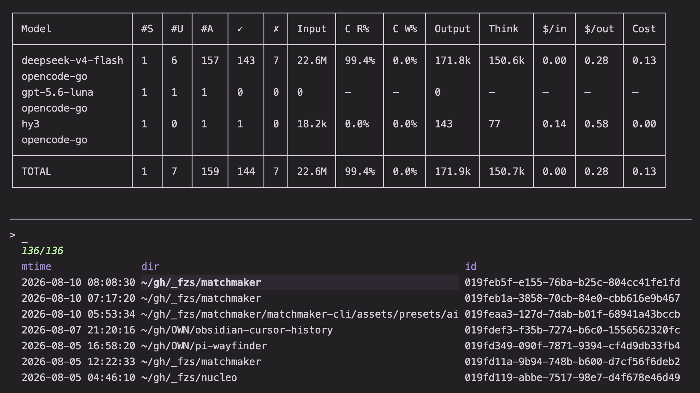
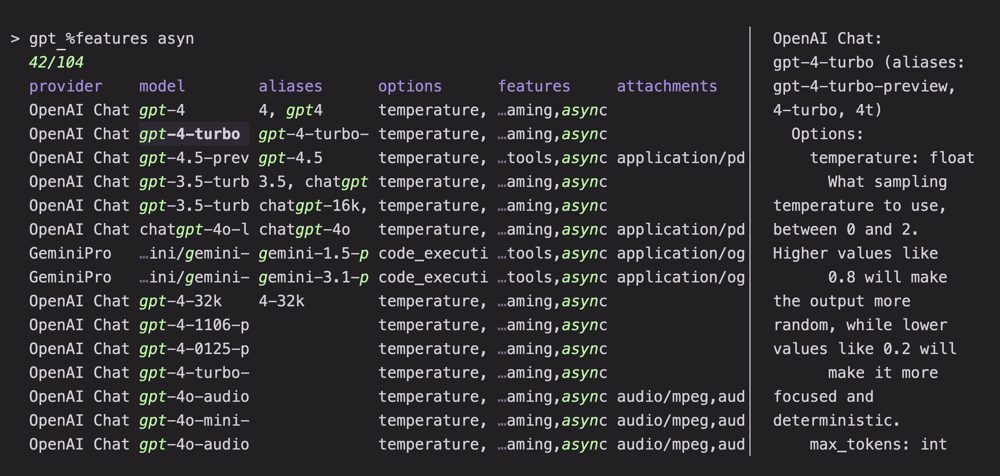
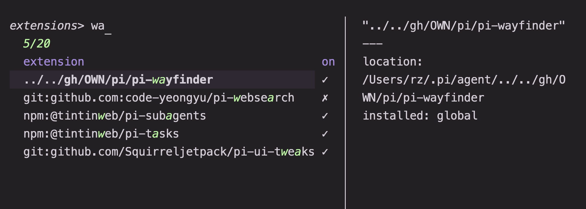

# Pi and LLM pickers

Pickers for the [Pi coding agent](https://github.com/badlogic/pi-mono) and the
[llm](https://llm.datasette.io/) CLI: resume previous sessions, inspect model
options, and manage installed Pi extensions.

## Usage

```sh
mm -o ai/pi_sessions
mm -o ai/llm
mm -o ai/pi_extensions
```

Requirements: `python3` and `bat` for the Pi presets.

## Presets

### `pi_sessions`

Browse and resume Pi agent sessions.

Sessions are read from `~/.pi/agent/sessions`. Each row is a session transcript
(`*.jsonl`); the preview shows its first prompt, the model used, token totals,
and the last response. The second preview tab breaks usage down with
`session_stats.py`, and the third shows the raw JSONL.

`<enter>` starts `pi` in the session's working directory with `--session`, while
`@return` (`alt-enter`) starts a forked session instead. `@show` exports the
session to HTML under `/tmp/pi/html` and opens it; this is the only action that
needs `node`. `@copy` copies the session id, and `@rm` deletes the session file
without asking for confirmation.

Requirements: `jq` for the previews, plus `node` for `@show`.





### `llm`

Pick an installed `llm` model.

Runs `llm models --options` and splits the output into one row per model. The
preview runs `llm models --options -m <model>`. Accepting a row
prints the model name, so it can be used in a pipeline:

```sh
llm -m "$(mm -o ai/llm)" "Summarize this"
```

Requirements: `llm` and the plugins that provide the models you use; `perl` is
used to parse `llm`'s output.



### `pi_extensions`

Manage the Pi extensions listed in `~/.pi/agent/mm_extensions`.

The file is a line-oriented list of JSON extension definitions. Lines starting
with `#` are disabled; enabled lines have no prefix. When the file is missing
or empty, the preset seeds it from the current global and project settings with
`pi_extensions_reconcile.py`. The rows are therefore a desired-state list, not
a live view of Pi: run `@reconcile` (`ctrl-r`) after changing extensions
elsewhere.

`@accept` toggles the selected extensions in the list and `@set global` /
`@set local` apply the list to `~/.pi/agent/settings.json` or
`.pi/settings.json` (with confirmation). `ctrl-n` installs a new extension from
a URL and appends it; `@rm` removes it from the list and runs `pi uninstall`;
`@prune` (`alt-p`) uninstalls extensions present in the global/project install
folders but absent from the list. `@prune`, `@rm`, and the apply actions prompt
before changing anything.

Requirements: `pi`. Set `MM_EXTENSIONS_FILE` to use a different list. `@open`
edits the relevant `settings.json` with `$EDITOR`.


