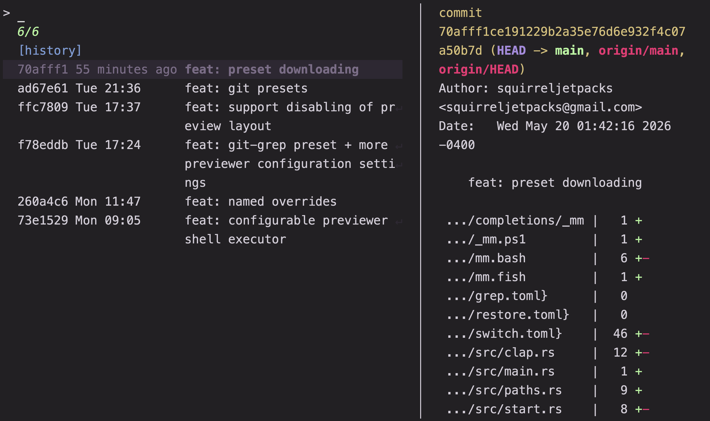
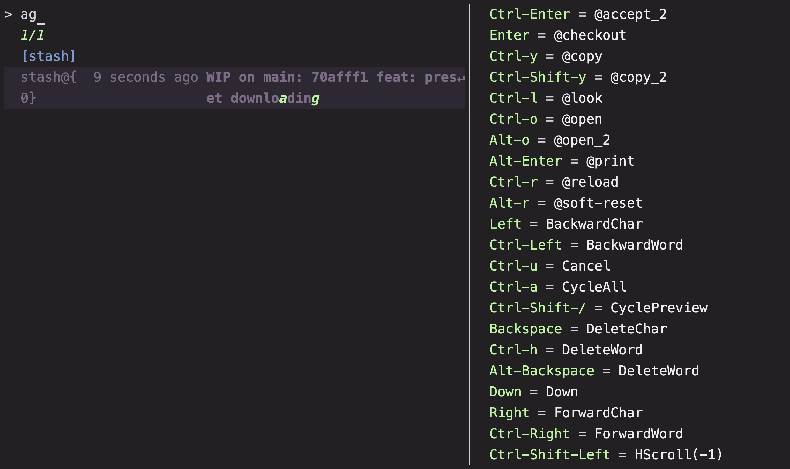
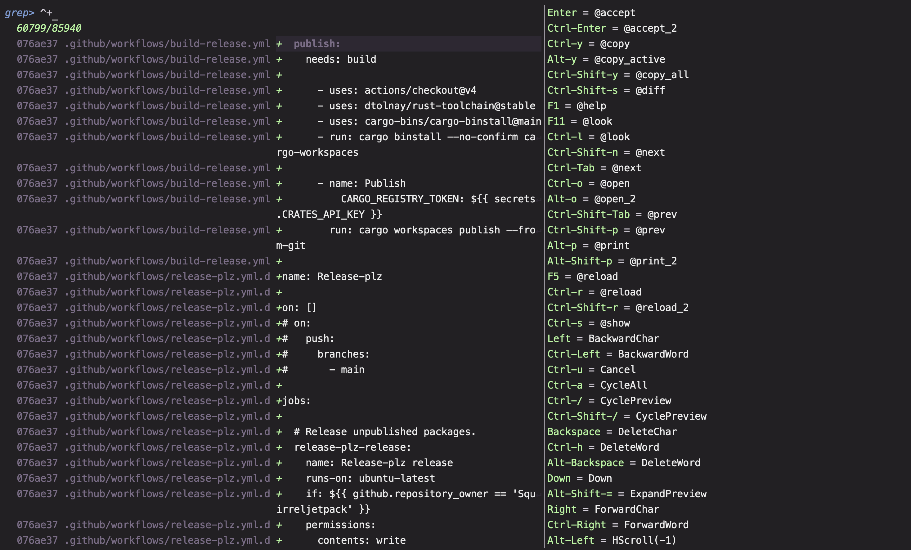
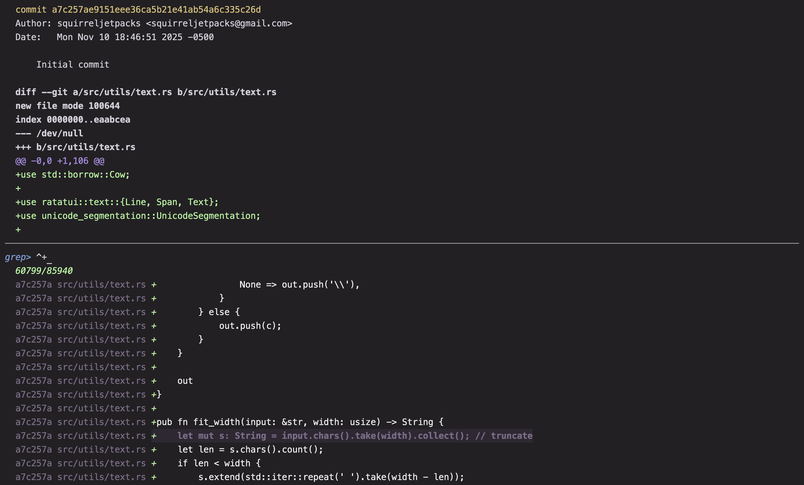

# Git

Interactive Git workflows sharing one keymap: review and stage changes, restore
files or commits from history, switch refs, and search historical diffs. The
pickers are meant to be used inside a repository and can be cycled without
leaving Matchmaker.

## Usage

```sh
mm -o git/status
mm -o git/restore
mm -o git/restore -- src/
mm -o git/switch
mm -o git/grep
```

Requirements: `git`, `awk`, and optionally `bat` for file previews. `$EDITOR`
and `$PAGER` are used for editing and paging. The presets change directory to
the repository root, so they work from any subdirectory.

## Presets

### `status`

Review and act on working-tree changes.

Each row is a changed path with its status code. `<enter>` stages the selected
paths, or unstages them when they are already fully staged. The preview tabs
show the unstaged diff, the staged diff, and the file's history.

Committing, stashing, restoring, untracking, and deleting are all available.
`@commit` prompts for a message; `alt-c` stages everything first. `@restore`
returns the selected paths to `HEAD` after confirmation, and `@stash` stashes
the selection with an optional message. `@untrack` runs `git rm --cached`;
`@rm` deletes the selected files from disk after confirmation, so use it only
for files you do not need. `@next` opens `restore`, and `@prev` wraps around to
`grep`.

### `restore`

Restore a file or revision from history, a stash, or the reflog.

The optional pathspec limits the history and the restore target to that path.
The tabs are history (`git log`), stashes, all refs, and reachable refs. Each
row is a ref. `<enter>` checks the selected ref or path into the working tree
without moving `HEAD`; if files are dirty it offers to proceed, stash the
affected paths, or cancel.

`@reset` is the history-rewriting action: on a commit it resets `HEAD` to the
selected ref and asks for mixed, soft, or hard; on a stash it applies the stash
and offers to drop, preserve, or revert it. `@clean` (`@rm`) stashes all changes
or squashes selected commits on the history tab, drops a stash on the stash
tab, and runs reflog expiration plus GC on the ref tabs. Tagging, renaming,
fixup/reordering, rebasing, and diff comparisons are also available from this
picker; the destructive variants all prompt first. `@next` opens `switch`, and
`@prev` returns to `status`.





### `switch`

Switch to a branch, tag, remote ref, or cached ref.

The tabs are local branches, tags, remote refs from `git ls-remote`, and cached
refs. `<enter>` switches to the selection. A dirty working tree prompts to
continue, stash, or cancel. Remote branches create or update a local tracking
branch, while tags and arbitrary refs detach `HEAD`. `@update` fetches or pulls
the current tab's refs, and `@delete` deletes branches, tags, or remote refs
after confirmation. `@rename`, `@add_remote`, `@add_branch`, and `@copy_remote`
cover the usual ref maintenance. `@next` opens `grep`, and `@prev` returns to
`restore`.

### `grep`

Search added and removed lines across repository history.

The populating command walks `git log -Dp` and emits one row per changed line,
with the commit, file, and line text. The previews show the commit summary, the
file diff for that commit, and the file contents at that revision. `<enter>`
prints the selected change, so the picker also works as a historical grep to
pipe into another command. This preset only reads history. `@next` opens
`restore` when the working tree is clean and `status` otherwise; `@prev`
returns to `switch`.





## Notes

`git/browse.toml` is not a standalone picker. It has only a bind block and no
source or previews, so it is intended as an override fragment layered onto
another preset rather than run directly.
