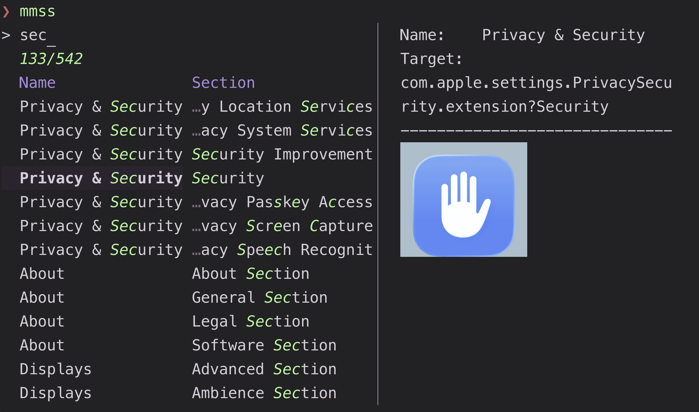

# macOS preference panes and services

Two pickers for macOS administration: open a System Settings pane, or inspect
and control the background services registered with `launchctl`.

## Usage

```sh
mm -o macos/prefpanes
mm -o macos/services
```

Requirements: macOS Tahoe for `prefpanes`, plus the built-in `defaults`,
`plutil`, `sips`, `mdfind`, `osascript`, and `open` tools. The folder includes
an arm64 `render_symbol` helper; rebuild it from `render_symbol.swift` if you
need another architecture. `services` needs `launchctl`; install `bat` for
syntax-highlighted plists and set `$EDITOR` for editing them.

## Presets

### `prefpanes`

Browse and open System Settings panes and installed third-party preference
panes.

Rows come from the bundled `extensions.csv` and from `.prefPane` bundles found
in `/Library/PreferencePanes` and `~/Library/PreferencePanes`. Each row is a
pane or a pane section. The preview resolves the pane's bundle, renders its icon
into `/tmp/mm_pref_*.png` (reusing the cached image on later runs), and shows the
open target.

`<enter>` opens the selected pane in System Settings; third-party bundles are
opened directly. `@record` (`ctrl-r`) asks the running System Settings app for
the current pane and its anchors and merges them into `extensions.csv`, so open
the pane you want to record first. `@show` copies the current pane id and
displays its anchors. `alt-s` shows the bundle, icon UTI, and symbol name used
for icon rendering. The CSV is written in place; review it before committing
changes if you keep it under version control.



### `services`

Inspect and control the services in your user's `launchctl` domain.

The populating command is `launchctl list`; each row is one service. The main
preview runs `launchctl print` on the resolved target, which is more useful than
the short list. The secondary preview shows the target, plist path, and program
path.

`<enter>` prints the selected service's PID and exits, which makes it easy to
pick a PID from a script. `@open` edits the service's plist with `$EDITOR`.
`@load` (`ctrl-t`), `@unload` (`ctrl-u`), `@restart` (`alt-r`), `@kill`
(`ctrl-k`), and `@pause` (`ctrl-p`) call the corresponding `launchctl`
operations; each asks for confirmation. `@copy` copies the plist path and
`@copy_all` copies the resolved launchctl target.

`launchctl list` shows the current user's domain, not system daemons; use
`sudo launchctl` outside this preset for system services.
