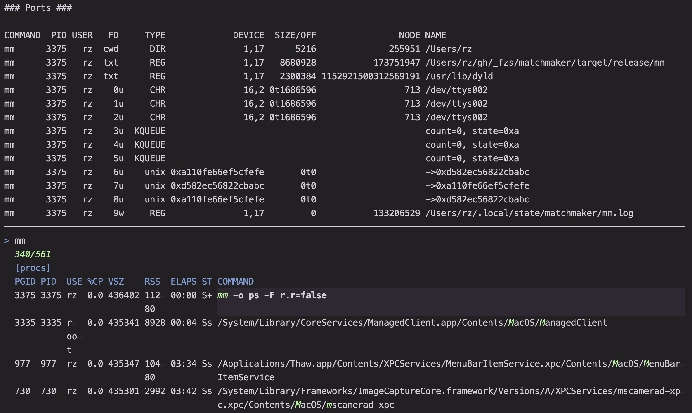

# Processes

Browse the process table, inspect a process tree, its resource usage and its
sockets, then signal or kill the selected processes.

## Usage

```sh
mm -o ps
mm --download ps
```

Requirements: `ps`, plus `pstree` (falling back to `ps --forest`), `top`, and
`lsof` for the previews. A missing tool leaves its preview tab empty. On Windows
the preset needs only PowerShell 5.1, which Windows 10 and 11 ship; the process
table comes from `Get-CimInstance Win32_Process` and the socket tab from
`Get-NetTCPConnection`, falling back to `netstat -ano`.

Rows come from `ps -eo pgid,pid,user,%cpu,vsz,rss,etime,stat,command`, split on
runs of spaces, and the command is the default search column. The header is the
label `[procs]`, so the column order is not otherwise on screen. A second header
tab lists listening and connected sockets instead, and the previews show the
process tree, live resource usage (`top -b -p`), and the selected process's open
files and sockets (`lsof -p`).

The abbreviation columns keep `ps`'s own names: `pgid` is the process group id
(the group leader is normally the shell that started the job), `vsz` and `rss`
are virtual and resident memory in KiB, `etime` is elapsed wall-clock time since
start, and `stat` carries the process state and its flags (`S` sleeping, `R`
running, `Z` zombie, `+` in the foreground, `s` session leader).

`<enter>` prints the selected PIDs, one per line, so the picker also works when
piped. `@return` prints the active column of the selection, and `@copy` copies
the PIDs.

The kill bindings signal the selected PIDs, their group leader, or their whole
process group. A single row is signalled immediately; a multi-row selection
asks for confirmation first.

| Bind           | Target                            | Signal    |
| -------------- | --------------------------------- | --------- |
| `ctrl-k`       | selection                         | `SIGTERM` |
| `alt-k`        | selection                         | `SIGKILL` |
| `ctrl-shift-k` | selection's group leader (`pgid`) | `SIGTERM` |
| `alt-shift-k`  | selection's group leader (`pgid`) | `SIGKILL` |
| `ctrl-g`       | selection's process group         | `SIGTERM` |
| `alt-g`        | selection's process group         | `SIGKILL` |

A process counts as gone once it exits or becomes a zombie. Each target is
waited on for `MM_KILL_TIMEOUT` seconds (default `1`); survivors are reported
as `Failed:`.

On Windows the same `mm -o ps` resolves to `win.main.toml`, which has the same
shape with six columns that have a cheap Windows equivalent: `PID`, `PPID`,
`CPU` (cumulative CPU seconds, like `TIME+`), `MEM` (working set in MiB),
`ELAPSED` and `COMMAND`. There is no `USER` or `STAT` column, and no preview for
resource sampling. The previews show the selected process's details, its direct
children, and its sockets. The second tab keeps the PID in the first column and
then lists `STATE`, `LOCAL`, `REMOTE`, `PROTO` and `PROCESS`, so the kill
bindings work from either tab.

Windows has no signals or process groups, so the two terminators stand in for
the signals and the group bindings are absent. Every kill asks for
confirmation.

| Bind           | Target    | Command                         |
| -------------- | --------- | ------------------------------- |
| `ctrl-k`       | selection | `Stop-Process`                  |
| `alt-k`        | selection | `taskkill /PID /F`              |
| `ctrl-shift-k` | selection | `Stop-Process` (walks the tree) |
| `alt-shift-k`  | selection | `taskkill /PID /T /F`           |


