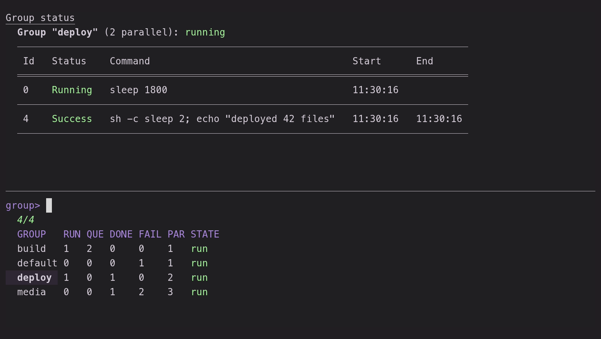
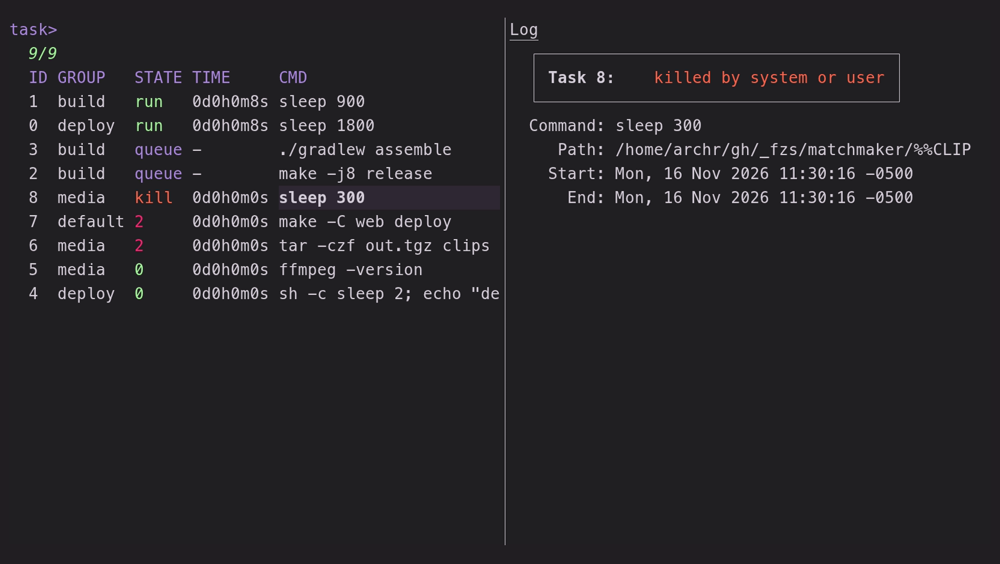

# Pueue pickers

Two pickers for the pueue task queue: browse groups, or browse tasks. They form
a ring, and `<enter>` on a group opens the task list filtered to it.

## Usage

```sh
mm -o pueue/groups
mm -o pueue/tasks
mm -o pueue/tasks -- GROUP...
```

Requirements: `pueue`, a running `pueued` daemon and `python3`. Both presets run
`./pueue.py`, which reads `pueue status --json`; set `PUEUE_CONFIG_PATH` to talk
to a non-default daemon.

A query searches the preset's default column: group names in `groups`, commands
in `tasks`. Prefix a word with a column name to search that column instead, e.g.
`%state pause`, `%group psp` or `%id 782`.

## Presets

### `groups`

One row per group: name, the running/queued/done/failed task counts, the number
of parallel slots and the group's compact state (`run`, `pause`, `reset`). The
counts are ignored for matching, so a plain query filters on group names and
`%state pause` filters on state.

`<enter>` opens `tasks` filtered to the selected groups, and `@next` opens it
unfiltered. `ctrl-p` pauses or resumes the selected groups. `ctrl-k` kills their
running tasks; pueue pauses a group whose tasks were killed, so it then reads
`paused`. `ctrl-d` removes the selected groups after confirmation: a group with
queued or running tasks is refused, and its finished tasks are cleaned first.
`ctrl-s` pages the summary across all groups and `ctrl-o` pages the selected
group's tasks. The preview shows the group's tasks in the top pane.



### `tasks`

One row per task: id, group, state, elapsed time and command. Running tasks come
first, then paused and queued ones, then finished ones newest first. States are
short and colored: `run`, `pause`, `queue`, `stash` or `lock` while pending, then
the exit code for finished ones (`0` green, anything else red) — or `kill`, `spawn`,
`dep` or `err` where pueue reports no code. The time cell holds the elapsed time
(`0d0h26m5s`, or `-` for a task that never ran); `alt-n` sorts it chronologically
because numeric sorting compares the duration segment by segment.

`<enter>` pages the task's log and `alt-enter` accepts with the bare task id
printed. `ctrl-p` pauses, `ctrl-g` starts and `ctrl-e` restarts finished tasks in
place. `ctrl-k` kills the selected tasks and waits until pueue reports them done,
so the reloaded list is already correct; `alt-k` sends `SIGKILL` instead.
`ctrl-d` removes finished tasks, and `ctrl-o` edits the command of a queued one.
`ctrl-s` pages the summary and `ctrl-t` jumps back to `groups`. Failures are
shown with pueue's own message before the picker returns. The preview shows the
task's log.


