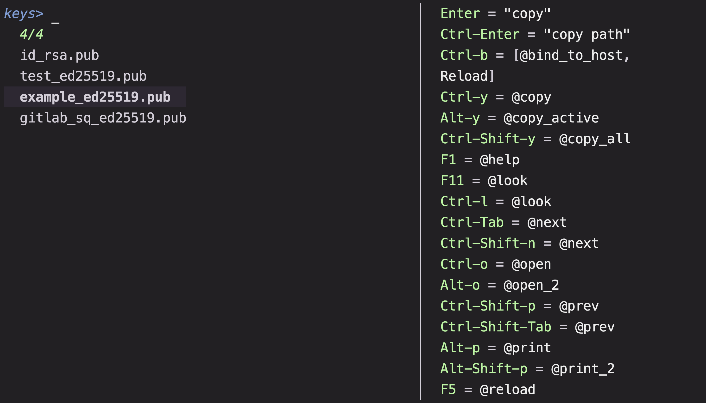
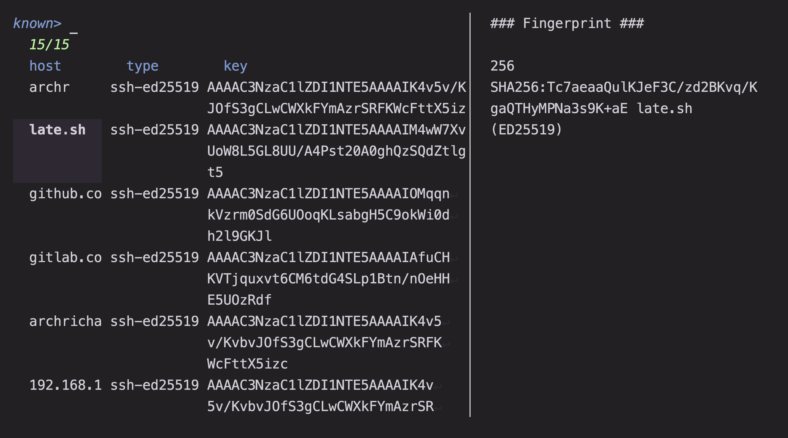

# SSH

Pickers for the pieces of an SSH setup: hosts from your config, public keys,
known hosts, and machines on your tailnet. Use them to connect quickly and to
clean up stale keys or host entries.

## Usage

```sh
mm -o ssh/hosts
mm -o ssh/keys
mm -o ssh/known
mm -o ssh/tailscale
```

Requirements: `ssh`, `ssh-keygen`, and `ssh-keyscan`. The hosts preview also
uses `nc` and `ping`, and the tailscale picker needs the `tailscale` CLI. `bat`
is optional for key previews, and `$EDITOR` is used when editing files.

## Presets

### `hosts`

Browse the hosts defined in your SSH configuration.

Reads `~/.ssh/config`, `~/.ssh/config.d/*`, and `/etc/ssh/ssh_config`,
skipping wildcard patterns and duplicate host names. Each row is one host.
`<enter>` runs `ssh <host>`; `@return` prints the host name. `@open_2` opens
the defining config file in `$EDITOR`, and `@test`
runs `ssh -vT` to show authentication details. The previews show the resolved
configuration (`ssh -G`), a connectivity check, and the host keys returned by
`ssh-keyscan`. Host definitions fragmented across multiple blocks are parsed
line by line and may not merge perfectly. `@next` opens `keys`, and `@prev`
wraps around to `tailscale`.

### `keys`

Browse the public keys in `~/.ssh`.

Each row is a `*.pub` file. The preview shows the key text and its SHA256
fingerprint from `ssh-keygen -lf`. `<enter>` copies the public key and exits;
`@return` copies its absolute path. `@open_2` edits the matching private key.
`@rm` permanently deletes both the public and private key files after a typed
confirmation. `@next` opens `known`, and `@prev` returns to `hosts`.



### `known`

Browse and test `~/.ssh/known_hosts`.

Each row is one known host. The preview shows the key fingerprint and, on
another tab, the keys `ssh-keyscan` currently returns.
`<enter>` prints the selected `known_hosts` line. `@show` runs `ssh -vT`
against the selected host; `@open` edits `~/.ssh/known_hosts`. `@rm` removes
the selected host key with `ssh-keygen -R` immediately, without a confirmation
prompt. `@next` opens `tailscale`, or `hosts` when the tailscale CLI is
unavailable; `@prev` returns to `keys`.



### `tailscale`

Browse machines on your tailnet and connect to them.

Rows come from `tailscale status`. `<enter>` prints the selected IP, `@open`
runs `tailscale ssh <hostname>`, and `@open_2` opens the machine list in the
Tailscale admin console. `ctrl-n` shows `tailscale netcheck`; the other preview
tabs show `tailscale ping` and the tailnet status JSON. `@next` wraps around to
`hosts`, and `@prev` returns to `known`.
