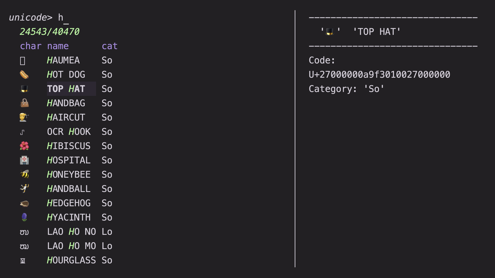
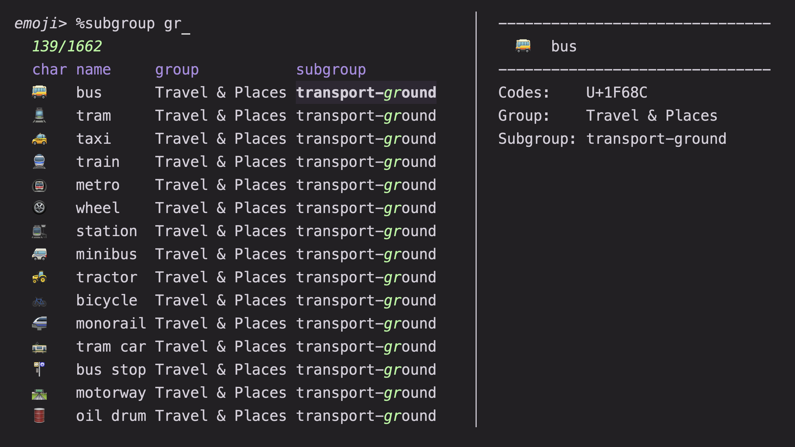

# Unicode and emoji picker

Search Unicode characters and emoji by name, category, LaTeX command, HTML
entity, or CLDR keywords, then copy the character or `\u{...}` escape sequence.
The picker works offline from compressed tables shipped with the preset.

## Usage

```sh
mm -o unicode
```

Requirements: `zstd` at runtime.

To regenerate `unicode.zst` and `emoji.zst` from upstream Unicode, CLDR,
[unicode-math](https://github.com/latex3/unicode-math), and WHATWG HTML entity
data, run `build.rs` with [`rust-script`](https://rust-script.org/) from this
directory:

```sh
rust-script ./build.rs
```

The builder defaults to the `modern` tier (single-grapheme emoji through E15.1
and terminal-safe Unicode symbols with English CLDR annotations). Pass
`--strict` for single-codepoint E13.0 emoji without ambiguous-width symbols,
`--full` for all fully-qualified emoji and Unicode symbols, `--nerd-fonts` to
include Nerd Font glyphs in `unicode.zst`, `--locale <tag>` (such as `de`,
`fr`, `ja`, or `zh-Hans`) for localized CLDR keywords, or `--no-cldr` to omit
CLDR keywords. Upstream downloads are cached under `.cache`.

The picker starts on the `unicode>` tab and cycles between `unicode>` and
`emoji>` with `@reload` and `@reload_2`. Each row has four columns: `char`,
`name`, `cat`, and `meta`. On the Unicode tab, `cat` is the Unicode General
Category (such as `Math_Symbol` or `Uppercase_Letter`) and `meta` holds any
LaTeX command, HTML entity, Nerd Font tag, or CLDR keywords. On the emoji tab,
`cat` is the emoji group and `meta` holds the subgroup and CLDR keywords.

The preview pane displays the `U+...` code point sequence, category or group,
and parsed metadata fields. `@show` lists the Unicode category names on the
Unicode tab and the group, subgroup, and keywords on the emoji tab.

`<enter>` copies the selected character or emoji to the clipboard and exits, and
`@copy` copies it without quitting. `@copy_all` copies Go/Rust-style
`\u{...}` escapes for every code point in the character or multi-codepoint
emoji sequence, and `@copy_meta` copies the `meta` field.




