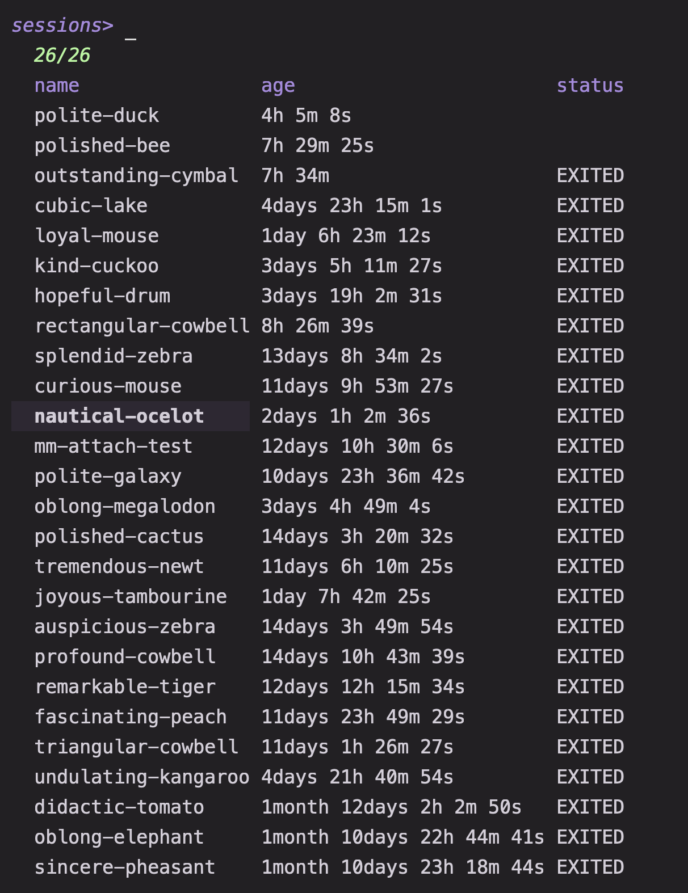

# Zellij pickers

Four pickers for Zellij: switch sessions, jump to a pane, or apply a layout.
They form a ring, and the pane pickers are skipped automatically when they
would be empty.

## Usage

```sh
mm -o zellij/session
mm -o zellij/current
mm -o zellij/layout
mm -o zellij/layout -- my-layout
mm -o zellij/other
```

Requirements: `zellij`, `jq`, and `awk`. `bat` is optional and used for cached
KDL previews.

## Presets

### `session`

Switch between Zellij sessions.

Every session is listed, running or exited (exited sessions are attached with
`zellij attach`, which can resurrect them). `<enter>` attaches from outside
Zellij or switches to the session from inside. The preview summarizes tabs and
pane titles; a second layout shows the active pane for a running session, or
the cached layout for an exited one. `@rm` kills the selected sessions after a
confirmation. `@print` and `@copy` emit or copy the selected names, and `@new`
starts a new session with Zellij's generated name. `@next` opens `current`, or
`layout` when there are no panes to focus; `@prev` opens `other`, or `layout`
when there are no other panes.

### `current`

Focus a pane in the current session.

Lists the session's terminal panes except the one running Matchmaker, so it
only produces rows from inside Zellij. `<enter>` focuses the selected pane.
`@print` emits `session<TAB>pane`, `@copy` copies `session:pane`, and `@rm`
closes the selected panes after confirmation. The preview follows the pane's
live screen. `@next` opens `layout`, and `@prev` returns to `session`.

### `other`

Jump to a pane in another session.

Lists panes from every other running session. `<enter>` switches to that session
with the pane focused; from outside Zellij it attaches afterwards. `@print` and
`@copy` use the same `session<TAB>pane` form as `current`, and `@rm` closes the
selected panes. `alt-d` kills the sessions containing the selected panes
(deduplicated) after confirmation. The preview shows the pane's live screen.
`@next` wraps around to `session`, and `@prev` returns to `layout`.

### `layout`

Apply a layout to the current tab or open it in a new tab.

Extra names passed after `--` are added to the list of built-in or user layouts.
The picker lists single-tab user layouts from Zellij's layout directory and
skips swap variants. `<enter>` applies the layout to the active tab and keeps
existing terminal panes that do not fit. `@return` applies it while replacing
the active tab's panes, closing terminals that do not fit, without confirmation
or undo. `@new` opens the layout in a new tab. The preview is the KDL that
Zellij resolves for the layout name. Run it from inside Zellij. `@next` opens
`other`, or `session` when there are no other panes; `@prev` opens `current`,
or `session` when there are no panes to focus.


